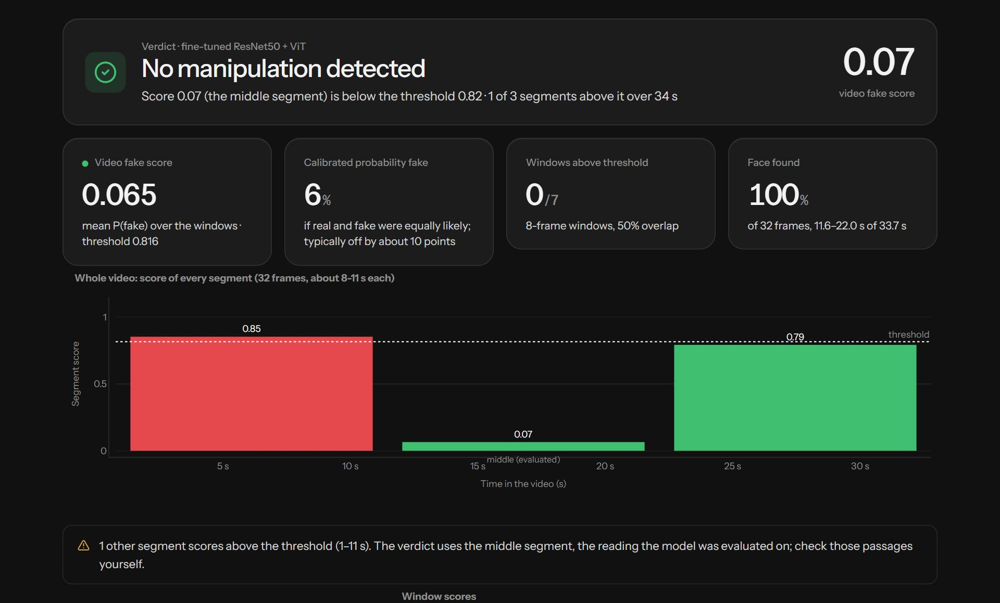
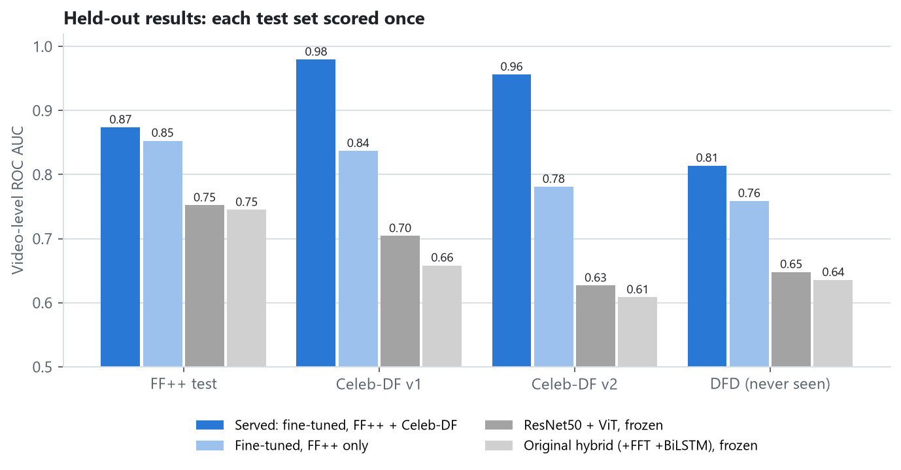
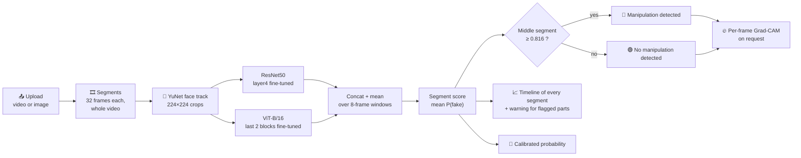
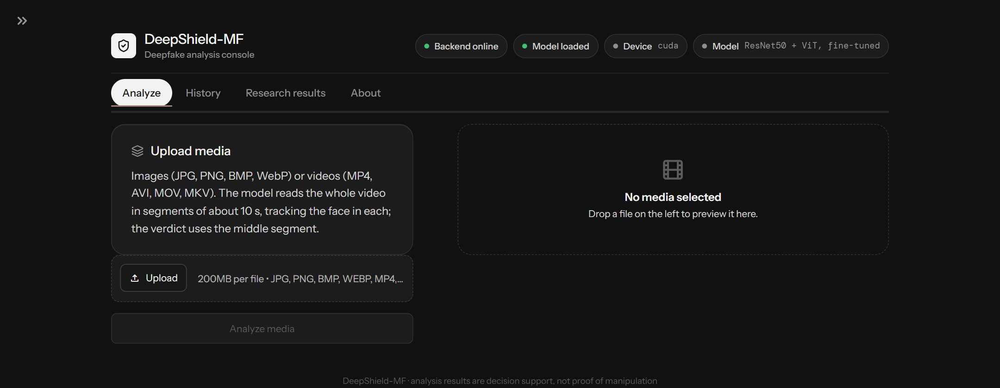
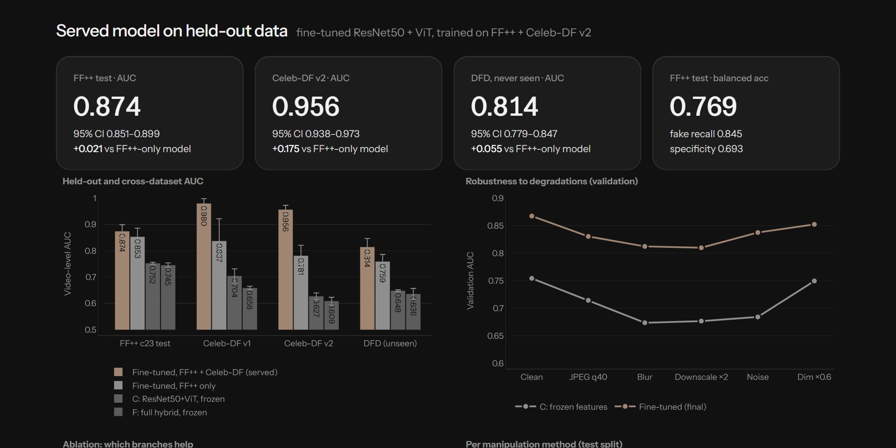
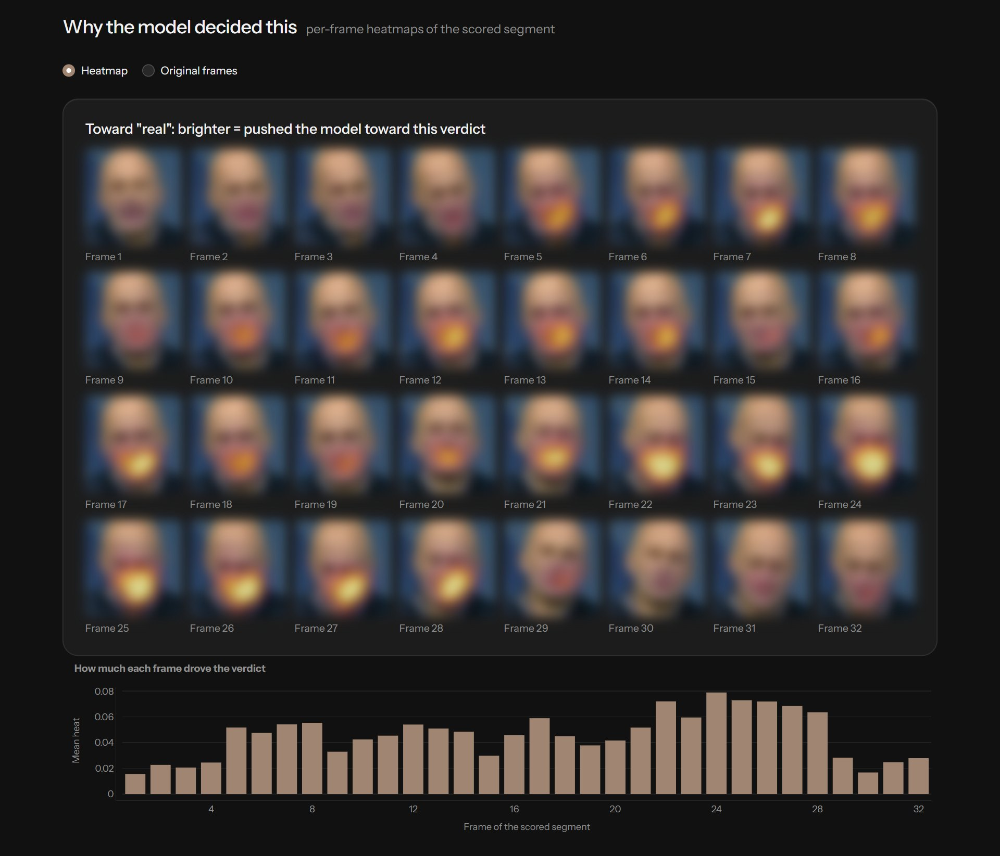
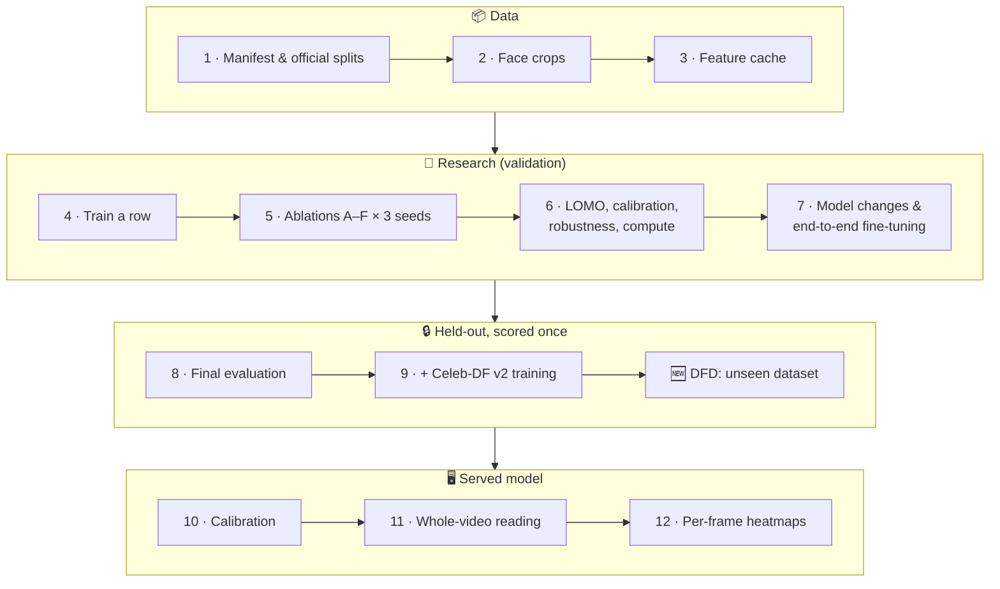
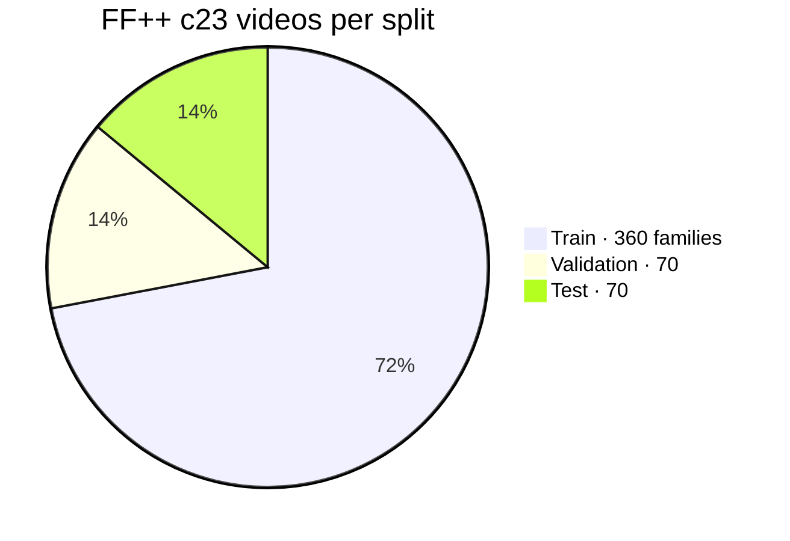
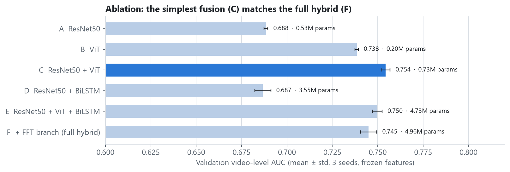

<div align="center">

# 🛡️ DeepShield-MF

**Deepfake video detection with CNN + Vision Transformer fusion, face tracking and whole-video analysis**

[](https://www.python.org/)
[](https://pytorch.org/)
[](https://github.com/huggingface/pytorch-image-models)
[](https://flask.palletsprojects.com/)
[](https://streamlit.io/)
[](#-license)

[Results](#-results-at-a-glance) · [How it works](#-how-it-works) · [The app](#️-the-app) · [Quick start](#-quick-start) · [Research pipeline](#-research-pipeline) · [Limitations](#️-limitations)



<sub>A 34-second DeepFakeDetection clip: the evaluated middle segment looks real (0.07), but the timeline flags the first ~10 seconds (0.85). Faces in all screenshots are blurred.</sub>

</div>

---

## ✨ What it does

| | |
| --- | --- |
| 🎞️ **Reads the whole video** | Cuts the upload into ~10 s segments of 32 frames, tracks the face in each and scores every segment. |
| 🧠 **Fine-tuned fusion model** | ResNet50 and ViT-B/16 with their last layers fine-tuned on face crops, averaged over 8-frame windows. |
| ⚖️ **Honest verdict** | One threshold (0.816) chosen on validation data only; a calibrated probability shown alongside, with its error. |
| 🔥 **Explains itself** | Per-frame Grad-CAM heatmaps of the segment behind the verdict, checked with a deletion test. |
| 🧪 **Evaluated properly** | Source-family-disjoint splits, every test set scored once under a protocol written beforehand, plus a dataset no model ever saw. |

> [!NOTE]
> The app serves the **fine-tuned ResNet50 + ViT trained on FaceForensics++ and Celeb-DF v2**. The original ViT frame classifier is still available with `SERVE_MODEL=vit`. The full hybrid (CNN + ViT + FFT + BiLSTM) is kept as a research model: it scored no better than the simpler fusion.

---

## 📊 Results at a glance



| Test set | Served model | What it means |
| --- | ---: | --- |
| 🎯 **FF++ c23 test** (839 videos) | **0.874** AUC (95% CI 0.851–0.899) | Same source as training, unseen source families |
| 🎭 **Celeb-DF v2** test list (516) | **0.956** (0.938–0.973) | Unseen videos, but celebrities also seen in training |
| 🆕 **DeepFakeDetection** (3,375) | **0.814** (0.779–0.847) | A dataset no model saw: catches 65% of fakes, flags 18% of real videos |

All numbers are video level, scored **once** per model and test set, with thresholds frozen on validation data. The rules were written in [`docs/final_evaluation_protocol.md`](docs/final_evaluation_protocol.md) before each score existed.

---

## 🧠 How it works



<details>
<summary><b>Why each step is there</b></summary>

* **Face tracking** is the single biggest gain: the same model scores 0.750 AUC on face crops vs 0.577 on whole frames.
* **Fine-tuning** the last ResNet50 stage and the last two ViT blocks is the change that matters: test AUC 0.853 vs 0.752 with frozen features.
* **Segments over the whole video**: the model was evaluated on one 32-frame segment, so the verdict still uses the middle one. Combining all segments (mean or maximum) did not do better on validation. The other segments are shown on a timeline instead, and a warning flags any above the threshold. On DFD that warning catches 17% of the fakes the verdict misses, at a 9% false-alarm rate on real videos.
* **Calibration**: the raw score is not a probability. Platt scaling fitted on validation brings the calibration error from 0.092 to 0.044, but it transfers unevenly (better on FF++ and DFD, worse on Celeb-DF), so the shown probability is approximate.
* **Heatmaps**: Grad-CAM of both branches toward the verdict. Hiding each frame's 5 hottest regions weakened "real" verdicts more than random regions in 94% of validation videos, but "fake" verdicts in only 65%, so maps of fake verdicts are a hint.

</details>

---

## 🖥️ The app

| 🏠 Console | 🔬 Research results tab |
| --- | --- |
|  |  |

<details open>
<summary><b>🔥 Per-frame heatmaps</b> (Show per-frame heatmaps under any result)</summary>
<br>


<sub>A real FF++ clip judged real: the model relied mostly on the mouth and lower face, more in frames 22–28.</sub>
</details>

The console has four tabs: **Analyze** (upload, verdict, timeline, heatmaps), **History** (this session's analyses), **Research results** (the evaluation, read live from `results/`) and **About**.

---

## 🚀 Quick start

> [!IMPORTANT]
> Datasets and model weights are **not** in the repository and are never downloaded automatically. The served model's checkpoint is produced by the research pipeline (Steps 1–9 below), or switch to the ViT baseline with `SERVE_MODEL=vit`.

**1. Clone and create one virtual environment** at the repository root (Python 3.10+; tested with 3.14.10 on Windows):

```bash
git clone https://github.com/NihaalNO/DeepShield-MF.git
cd DeepShield-MF
```

```powershell
py -3 -m venv .venv
.venv\Scripts\activate
```

On Linux / macOS: `python3 -m venv .venv && source .venv/bin/activate`. If PowerShell refuses `Activate.ps1`, call `.venv\Scripts\python` directly.

**2. Install PyTorch, then everything else.** Pick one PyTorch build, then the shared requirements (pip keeps the build you installed):

```bash
python -m pip install torch torchvision --index-url https://download.pytorch.org/whl/cu126
```

```bash
python -m pip install -r requirements.txt
```

Use `--index-url https://download.pytorch.org/whl/cpu` for a CPU-only build. Check with `python -c "import torch; print(torch.__version__, torch.cuda.is_available())"`.

**3. Run the backend and the console** in two terminals from the repository root:

```bash
python backend/app.py
```

```bash
python -m streamlit run streamlit_app.py
```

Open http://localhost:8501. The backend listens on http://127.0.0.1:5000 (`/health` shows what it serves). Optional: copy `.env.example` to `.env` to change settings.

<details>
<summary><b>Expected backend log</b></summary>

```text
Using device: cuda
Serving model: finetuned
Fine-tuned model loaded from ...\results\ffpp_c23\e2e_finetune_aug-frame_ffpp+celebdf\seed0\checkpoints\best_trainable.pth (threshold 0.8161)
Class mapping (output index -> label): {0: 'fake', 1: 'real'}
Starting DeepShield backend on http://127.0.0.1:5000  (health: /health, inference: POST /predict)
```

Without the checkpoint the backend still starts, but `/health` reports `model_loaded: false` and `/predict` returns HTTP 503 instead of guessing with untrained weights.
</details>

---

## 🗂️ Project structure

```text
DeepShield-MF/
├── backend/app.py              # Flask API: /health, /predict (SSE), /explain
├── streamlit_app.py            # the analysis console
├── deepshield/                 # library: paths, data, models, metrics, engine,
│                               #   backbones, segments (whole video), serving, explain (Grad-CAM)
├── scripts/                    # research pipeline: manifests, face crops, features, training,
│                               #   ablations, analyses, fine-tuning, final evaluation, calibration
├── manifests/                  # tracked dataset manifests and official splits (FF++, Celeb-DF, DFD)
├── docs/final_evaluation_protocol.md   # evaluation rules, each written before its scores
├── assets/face_detector/       # YuNet face detector (ONNX)
├── assets/readme/              # images of this README
├── notebooks/                  # original notebooks (ViT baseline, hybrid, fusion experiments)
├── data/  results/             # datasets and all outputs (NOT in git)
├── requirements.txt            # the single dependency list
├── .env.example                # configuration template
├── Dockerfile  space/          # backend container and Hugging Face Space (serve the ViT baseline)
└── .streamlit/config.toml      # console theme
```

---

## 🔬 Research pipeline



All locations live in `deepshield/paths.py`. Point `DEEPSHIELD_FFPP_DIR`, `DEEPSHIELD_CELEBDF_V1_DIR` and `DEEPSHIELD_CELEBDF_V2_DIR` at the downloads in `.env`; nothing is copied.



> [!WARNING]
> The **test split stays untouched** until the final evaluation. `FeatureStore.split_rows("test")` raises an error unless called with `allow_test=True`, and the training scripts never do that.

<details>
<summary><b>Steps 1–4 · data, features and one training run</b></summary>

**Dataset layout** (official FaceForensics++ structure):

```text
<DEEPSHIELD_FFPP_DIR>/
├── original_sequences/youtube/c23/videos/NNN.mp4
└── manipulated_sequences/{Deepfakes,Face2Face,FaceShifter,FaceSwap,NeuralTextures}/c23/videos/TTT_SSS.mp4
```

**Step 1 · manifest and splits** (about a minute):

```bash
python scripts/build_manifest.py
```

Writes `manifests/ffpp_c23.csv` (one row per video: label, method, target and source ID, source family, split, frame count, size). A fake `TTT_SSS` and its two originals form one source family; families follow the official split in `manifests/ffpp_official_splits/` (360/70/70), so none is shared between train, validation and test.

**Step 2 · face crops** (about 1.5 h for 6,000 videos with 8 workers, resumable):

```bash
python scripts/extract_faces.py --workers 8
```

Samples 32 frames per video (every 8th frame, centred), tracks one face with YuNet and writes 224×224 crops and full frames to `data/ffpp_c23/{faces,fullframe}/`, plus `frame_index.csv`. Videos with a face in fewer than half of the frames are marked `failed`.

**Step 3 · cache backbone features** (about 20 min per variant on an RTX 3050):

```bash
python scripts/cache_features.py --variant faces
```

```bash
python scripts/cache_features.py --variant fullframe
```

Stores ResNet50 (2048-d) and ViT (768-d) features as float16 and grayscale frames for the FFT branch in `data/ffpp_c23/features/<variant>/`.

**Step 4 · train and validate one ablation row:**

```bash
python scripts/train.py --exp F --seed 0
```

`--exp`: A ResNet50, B ViT, C ResNet50+ViT (mean-pooled), D ResNet50+BiLSTM, E ResNet50+ViT+BiLSTM, F full hybrid with FFT. A video's 32 frames give 7 overlapping 8-frame windows; the video score is the mean window P(fake), and the threshold maximises balanced accuracy on validation. Runs write `config.json`, `checkpoints/best.pth` (with `class_names` and threshold), `logs/history.csv`, `metrics/val_metrics.json` and `predictions/val_videos.csv` under `results/ffpp_c23/<run>/seed<S>/`.
</details>

<details>
<summary><b>Steps 5–7 · ablations, analyses and model changes</b></summary>

**Step 5 · ablation matrix** (resumable):

```bash
python scripts/run_ablations.py
```

Rows A–F with 3 seeds, then the frame-order shuffle test, sequence lengths 4/16 and the full-frame comparison. `scripts/summarize.py` writes `results/ffpp_c23/summary/ablation_table.md`.

**Step 6 · analysis of trained runs** (validation only):

| Script | What it does |
| --- | --- |
| `scripts/run_lomo.py` | Leave-one-method-out: train on four manipulation methods, score the fifth |
| `scripts/calibration.py` | ECE, Brier and NLL, raw and after cross-fitted Platt scaling |
| `scripts/robustness.py` | Re-score on JPEG, blur, downscaling, noise and brightness changes |
| `scripts/explain_occlusion.py --run-dir <run>/seed0` | Occlusion maps (7×7) and a deletion test |
| `scripts/profile_compute.py` | Time per stage, parameters and peak GPU memory |

**Step 7 · model changes**:

```bash
python scripts/cache_extra_backbone.py --backbone efficientnet_b0
```

```bash
python scripts/run_improvements.py
```

```bash
python scripts/finetune_e2e.py --mode finetune --aug sequence
```

`run_improvements.py` tests branch projections (I), a learned branch gate and its ablation (J, J0), a causal LSTM (K), EfficientNet-B0 (L) and FFT band variants (M1–M3). `finetune_e2e.py` trains on face-crop pixels: `--mode frozen|finetune`, `--aug none|sequence|frame`, 120 training families by default (`--train-families 360` for all, about 2 h on a 6 GB GPU).
</details>

<details>
<summary><b>Steps 8–9 · final evaluation and the second domain</b></summary>

**Step 8 · final evaluation** (run once, after all choices are made on validation):

```bash
python scripts/finetune_e2e.py --mode finetune --aug frame --train-families 360 --name e2e_finetune_aug-frame_final
```

```bash
python scripts/final_eval.py
```

Scores the models fixed in `docs/final_evaluation_protocol.md` with frozen thresholds; writes `results/final/` and never overwrites a result.

**Celeb-DF test lists** (repeat with `v1` / `celebdf_v1`):

```bash
python scripts/build_manifest_celebdf.py --version v2
```

```bash
python scripts/extract_faces.py --dataset celebdf_v2
```

```bash
python scripts/cache_features.py --dataset celebdf_v2 --variant faces
```

**Step 9 · second domain (FF++ + Celeb-DF v2).** The FF++-only model called many real Celeb-DF videos fake: its only real training videos were 720 FF++ news clips.

```bash
python scripts/build_manifest_celebdf_train.py
```

```bash
python scripts/extract_faces.py --dataset celebdf_v2_train
```

```bash
python scripts/finetune_e2e.py --mode finetune --aug frame --train-families 360 --extra-dataset celebdf_v2_train --name e2e_finetune_aug-frame_ffpp+celebdf
```

```bash
python scripts/final_eval.py --models final_cdf
```

The manifest excludes every video of both Celeb-DF test lists (v1 is a byte-identical subset of v2), keeps all reals, subsamples fakes (1,500 train, 300 validation) and keeps 6 celebrities for validation only. After this step Celeb-DF tests are same-dataset tests (54 of 59 test celebrities also appear in training).

**Unseen-dataset test (DFD).** Download FF++'s `DeepFakeDetection` and `DeepFakeDetection_original` (c23) into `DEEPSHIELD_FFPP_DIR`, then:

```bash
python scripts/build_manifest_dfd.py
```

```bash
python scripts/extract_faces.py --dataset dfd_c23
```

```bash
python scripts/cache_features.py --dataset dfd_c23 --variant faces
```

```bash
python scripts/final_eval.py --datasets dfd
```

DFD is never used for training, selection or thresholds. 43 videos without a face track and 13 clips shorter than 32 crops are left out (3,375 remain).
</details>

<details>
<summary><b>Steps 10–12 · calibration, whole-video reading and heatmaps</b></summary>

**Step 10 · calibration of the served model:**

```bash
python scripts/calibrate_served.py
```

Platt scaling p = sigmoid(a·logit(score) + b) on validation scores, weighted so both datasets and both classes count equally; writes `calibration.json` next to the checkpoint's run directory. The recorded rule "calibrated p ≥ 0.5" would have replaced the threshold only with higher validation balanced accuracy; it did not (0.838 vs 0.840), so the threshold stays 0.816.

**Step 11 · whole-video reading:**

```bash
python scripts/eval_segments.py
```

`deepshield/segments.py` repeats the evaluated 32-frame segment over the whole video (at most 40 segments). The script scores every segment of the validation and test videos (resumable), chooses the aggregation rule on validation (middle 0.908, mean 0.908, max 0.903 mean AUC: the middle segment stays) and writes `aggregation.json`. Scoring every segment reproduces the stored test scores to within 3·10⁻⁵.

**Step 12 · per-frame heatmaps:** served by `POST /explain` (`deepshield/explain.py`). Per-frame occlusion was tried first and dropped (hiding one cell of one frame moves the log-odds by about 0.01). The deletion test on 200 validation videos is in `results/final/heatmap_deletion_val.json`.
</details>

---

## 🧪 What the experiments showed



* 🏆 **Fine-tuning is the change that matters**: validation AUC 0.670 → 0.774–0.796 on the same 120-family subset, 0.867 on all training data, 0.853 on the test split.
* ➖ **The hybrid's extra parts add nothing on frozen features**: ResNet50 + ViT with mean pooling (C, 0.73M trainable parameters) matches the full hybrid with FFT and BiLSTM (F, 4.96M) on validation, test and Celeb-DF.
* 🔀 **The BiLSTM ignores frame order**: shuffling frames changes AUC by less than 0.001; window lengths 4, 8 and 16 make no difference.
* 🙂 **Face cropping is worth about +0.17 AUC** (0.750 vs 0.577 on whole frames).
* 🆕 **Unseen manipulation methods cost 0.07–0.14 AUC** (leave-one-method-out).
* 🌫️ **Degradations**: blur and downscaling break the frozen models' threshold (specificity 0.69 → 0.17 at mild blur); the fine-tuned model holds 0.81–0.83 AUC.
* 🧩 **Section 16.4 head changes did not help** (projections, learned gate, causal LSTM, FFT bands); EfficientNet-B0 beat ResNet50 alone (+0.050) but not ResNet50 + ViT.
* 🎭 **Training on a second dataset helped beyond it**: on DFD, which no model saw, 0.814 AUC vs 0.759 for the FF++-only model.
* ⚖️ **Thresholds transfer badly between datasets**: with one threshold, real FF++ test videos called fake rose from 19% to 31% while Celeb-real fell from 50% to 21%.

<details>
<summary><b>📋 Full result tables</b></summary>

**Served model vs FF++-only model** (95% CI from resampling source families or identities):

| Data | FF++-only model | FF++ + Celeb-DF v2 model (served) |
| --- | ---: | ---: |
| FF++ test AUC | 0.853 | **0.874** (0.851–0.899) |
| Celeb-DF v1 test AUC | 0.837 (unseen dataset) | **0.980** (0.949–0.998), same dataset |
| Celeb-DF v2 test AUC | 0.781 (unseen dataset) | **0.956** (0.938–0.973), same dataset |
| Real Celeb-real test videos called fake | 50% | 21% |
| Real FF++ test videos called fake | 19% | 31% |
| **DFD test AUC (unseen, 3,375 videos)** | 0.759 (0.729–0.786) | **0.814** (0.779–0.847) |
| DFD: fakes caught / real videos called fake | 59% / 20% | 65% / 18% |

**FF++-only models** (thresholds frozen from FF++ validation; C and F: mean ± std over 3 seeds):

| Data | Model | AUC | Balanced acc | Fake recall | Specificity |
| --- | --- | ---: | ---: | ---: | ---: |
| FF++ test (839) | Fine-tuned ResNet50+ViT | **0.853** (0.823–0.886) | 0.795 | 0.783 | 0.807 |
| | C: ResNet50+ViT, frozen | 0.752 ± 0.004 | 0.672 | 0.729 | 0.614 |
| | F: full hybrid, frozen | 0.745 ± 0.009 | 0.676 | 0.732 | 0.619 |
| Celeb-DF v1 (100) | Fine-tuned ResNet50+ViT | **0.837** (0.740–0.922) | 0.741 | 0.903 | 0.579 |
| | C | 0.704 ± 0.027 | 0.572 | 0.968 | 0.175 |
| | F | 0.658 ± 0.007 | 0.532 | 0.914 | 0.149 |
| Celeb-DF v2 (516) | Fine-tuned ResNet50+ViT | **0.781** (0.738–0.821) | 0.718 | 0.882 | 0.554 |
| | C | 0.627 ± 0.013 | 0.578 | 0.881 | 0.275 |
| | F | 0.609 ± 0.015 | 0.565 | 0.861 | 0.269 |

FF++ test AUC per method (FF++-only model): Deepfakes 0.929, Face2Face 0.880, FaceShifter 0.859, FaceSwap 0.847, NeuralTextures 0.750.

**Calibration of the served model** (class-balanced ECE, lower is better):

| | Validation | FF++ test | Celeb-DF v1 | Celeb-DF v2 | DFD |
| --- | ---: | ---: | ---: | ---: | ---: |
| Raw score | 0.092 | 0.159 | 0.106 | 0.109 | 0.127 |
| Platt-calibrated | 0.044 (cross-fitted) | 0.138 | 0.141 | 0.126 | 0.097 |

**ViT baseline** (`notebooks/DD_ViT_Final.ipynb`, random 80/20 split of frames, so inflated by leakage): best validation accuracy 88.13%, weighted precision / recall / F1 0.883.

**Compute** (GPU, one segment): about 1 s per video end to end, dominated by decoding and face detection; about 6 s on a CPU. Heatmaps add about 2 s per segment.
</details>

---

## ⚙️ Configuration

All settings are optional; both `backend/app.py` and `streamlit_app.py` read `<repo>/.env` (see `.env.example`), and real environment variables win.

| Variable | Default | Used by |
| --- | --- | --- |
| `SERVE_MODEL` | `finetuned` (`vit` in the Docker image) | backend: which model `/predict` serves |
| `FINETUNED_CHECKPOINT` | `results/ffpp_c23/e2e_finetune_aug-frame_ffpp+celebdf/seed0/checkpoints/best_trainable.pth` | backend (`finetuned`) |
| `MODEL_PATH` | `backend/models/best_vit_model.pth` | backend (`vit`) |
| `MODEL_URL`, `MODEL_SHA256` | unset | backend: download the ViT checkpoint if missing |
| `CLASS_NAMES` | `fake,real` | backend: output index → label |
| `HOST` / `PORT` | `127.0.0.1` / `5000` | backend |
| `MAX_CONTENT_LENGTH_MB` | `100` | backend upload limit |
| `CORS_ALLOWED_ORIGINS` | all | backend |
| `DEEPSHIELD_BACKEND_URL` | `http://127.0.0.1:5000` | console |
| `DEEPSHIELD_FFPP_DIR`, `DEEPSHIELD_CELEBDF_V1_DIR`, `DEEPSHIELD_CELEBDF_V2_DIR` | `<repo>/data/...` | research scripts |
| `DEEPSHIELD_DATA_DIR` | `<repo>/data` | notebooks and derived data |

<details>
<summary><b>🔌 API reference</b></summary>

* `GET /health` → `{status, serve_model, threshold, calibrated, device, model_loaded, model_error, model_arch, model_path, class_names, max_upload_mb, model_url_set}`
* `POST /predict` (multipart field `file`) → Server-Sent Events, one JSON object per `data:` line. Errors arrive as `{"error": ...}`, with `"kind": "no_face"` when no face was found.
  * `SERVE_MODEL=finetuned`: `{"stage": "plan", "segments", "video_seconds"}`, one `{"stage": "segment", "done", "of", "score"}` per segment, then `{"stage": "done", "model_kind": "finetuned", "rule", "score", "threshold", "p_calibrated", "label", "segments", "middle", "decider", "segments_scored", "window_probs", "windows_fake", "mode", "evaluated", "frames_analyzed", "face_rate", "segment_seconds", "video_seconds", "thumbs", "explain_id"}`. `segments` lists `start_s`, `end_s`, `score` (`null` without a face) and `face_rate`; `window_probs`, `thumbs` and `segment_seconds` belong to the segment that decided the verdict.
  * `SERVE_MODEL=vit`: `{total_frames, real_count, fake_count, real_percentage, fake_percentage}` after every sampled frame (~2 per second).
* `POST /explain` (JSON `{"id": explain_id}`, `finetuned` only) → `{verdict, segment_score, frames: [{overlay, image, heat_mean, heat_max}]}`; per-frame Grad-CAM overlays as JPEG data URLs. HTTP 404 once the analysis has expired (the last 16 are kept, per backend process).

```bash
curl http://127.0.0.1:5000/health
curl -N -F "file=@path/to/video.mp4" http://127.0.0.1:5000/predict
```
</details>

<details>
<summary><b>💾 Model weights and outputs</b></summary>

| File | Model | Used by |
| --- | --- | --- |
| `results/ffpp_c23/e2e_finetune_aug-frame_ffpp+celebdf/seed0/checkpoints/best_trainable.pth` | fine-tuned layers of ResNet50 + ViT and the head (the rest comes from `timm` pretrained weights) | backend (`finetuned`) |
| `…/calibration.json`, `…/aggregation.json` | calibration map and segment rule | backend |
| `backend/models/best_vit_model.pth` | `timm` `vit_base_patch16_224`, 2 classes | backend (`vit`), Docker |

Weights are git-ignored. The ViT checkpoint is also published at https://huggingface.co/RohRoos84/deepshield-model; set `MODEL_URL` (and optionally `MODEL_SHA256`) to download it on startup. **Class order everywhere: index 0 = fake, 1 = real**; checkpoints carry their `class_names`, and loading refuses a different order.

The backend saves nothing: an upload lives in the OS temp folder only while its request runs. Research outputs go to `results/` (git-ignored), notebooks write to `results/<experiment>/`.

**Docker** (`Dockerfile`, port 7860) and `space/` copy only `backend/`, so they serve the ViT baseline (`SERVE_MODEL=vit`).
</details>

<details>
<summary><b>📓 Notebooks</b></summary>

Open them with the project `.venv` as kernel. Each starts with a *Project paths* cell that finds the repository root.

| Notebook | Purpose |
| --- | --- |
| `frac_df_cnnvit_fft_temporal.ipynb` | Hybrid research model: 8-frame sequences → ResNet50 + ViT + FFT → BiLSTM |
| `DD_ViT_Final.ipynb` | ViT baseline (frame-level split; source of `best_vit_model.pth`) |
| `deepfake_cnn_vit.ipynb` | Frame extraction + ResNet50/ViT fusion |
| `frac_df_cnnvit.ipynb` | Frozen ResNet50/ViT fusion on 30% of frames |
| `deepfake_detection_vit_best.ipynb` | Archived Colab experiment, not runnable as-is |

The notebooks read frames from `data/FF_frames/{fake,real}/<video_id>_<frame>.jpg` (index 0 = fake, 1 = real). On Windows, set `num_workers=0` in `DataLoader` calls if training hangs.
</details>

---

## ⚠️ Limitations

* 🆕 **New generators.** All training fakes come from 2019–2020 face swaps and reenactments. Diffusion-based swaps, lip-sync models and fully generated video are unseen methods; expect lower accuracy.
* 🎯 **"Real" is weak evidence on new footage.** On DFD the served model misses 35% of fakes at its threshold and flags 18% of real videos. Treat a verdict as a signal, not proof.
* ⚖️ **One threshold, several domains.** 0.816 was chosen on FF++ + Celeb-DF validation data; a new source shifts the balance between missed fakes and false alarms.
* 🙂 **Faces only.** One tracked face (the largest) is judged; videos without a visible face are refused; audio is not analysed. Stills were never evaluated.
* 🎞️ **Verdict from one segment.** The whole video is scored and shown, but the verdict uses the middle segment; flagged segments elsewhere are warnings.
* 🔥 **Heatmaps of "fake" verdicts are only a hint** (65% in the deletion test).
* 🎲 **Single training runs.** Each fine-tuned model is one seed; its numbers carry bootstrap CIs, not seed variance.
* 🖥️ **Deployment.** The Flask dev server is for local use; Docker and `space/` still serve the ViT baseline; heatmaps need the single-process server.
* 📓 The ViT baseline's 88% comes from a frame-level split and is inflated by leakage. `deepfake_detection_vit_best.ipynb` does not run as-is.

---

## 📄 License

This project is intended for educational, research and experimental purposes. FaceForensics++, Celeb-DF and DeepFakeDetection are used under their own research licences and are not redistributed; faces in the screenshots are blurred.

Shubham Kumar
